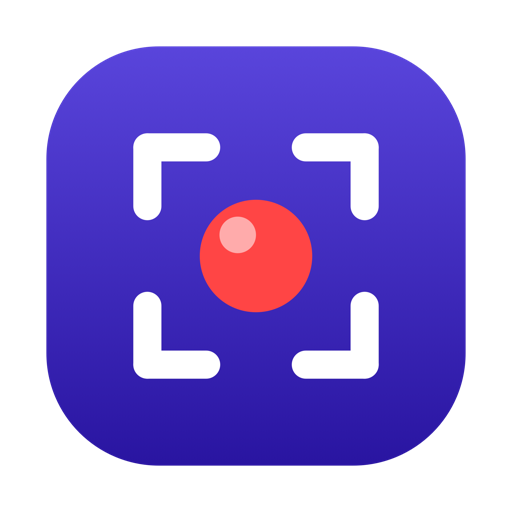
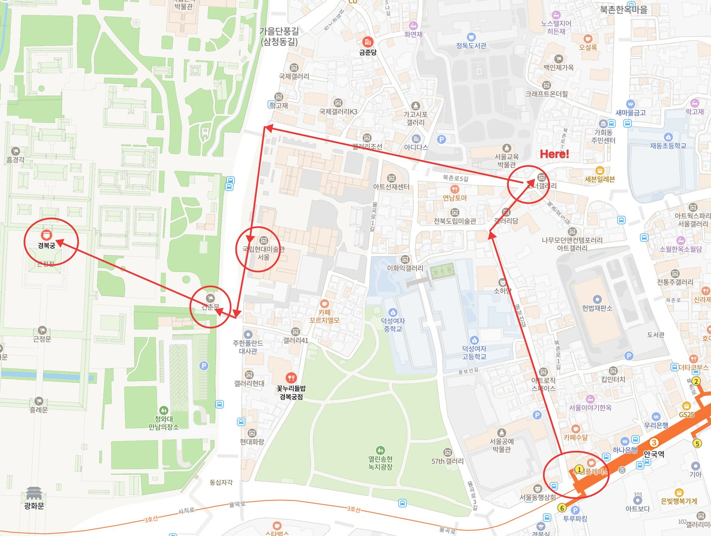
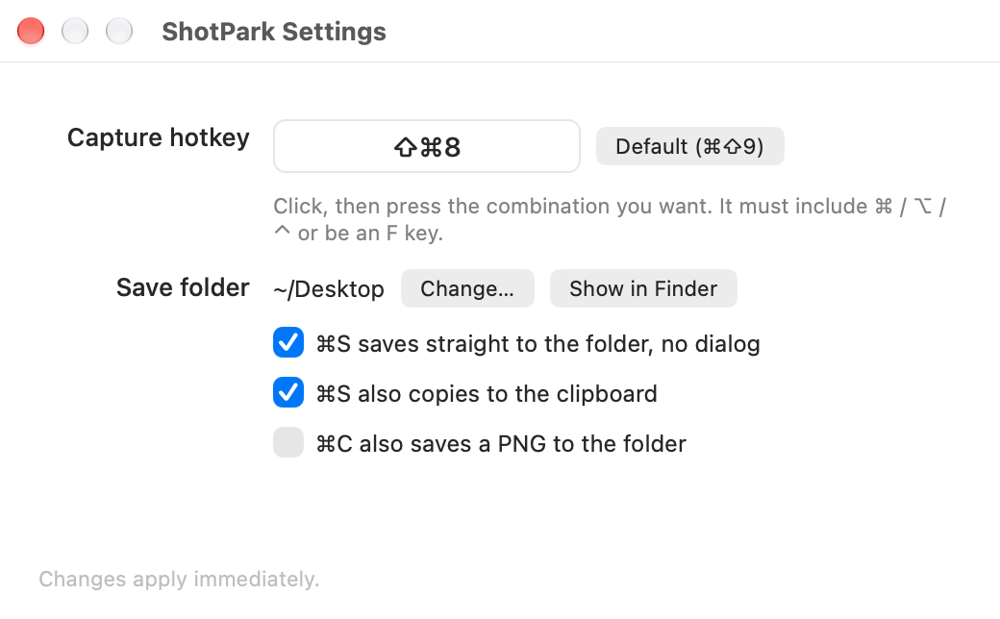

<p align="center">
  
</p>

<h1 align="center">ShotPark</h1>

<p align="center">
  The fastest way to grab part of your screen, mark it up and send it — on a Mac.<br>
  <b>Native Mac app (Apple Silicon · Intel)</b> · zero dependencies · lives in the menu bar
</p>

<p align="center">
  <a href="https://github.com/chiyodad/shotpark/releases/latest"></a>
  <a href="https://github.com/chiyodad/shotpark/releases"></a>
  
  
  <a href="LICENSE"></a>
  <a href="https://buymeacoffee.com/chiyodad"></a>
</p>

<p align="center">
  <a href="https://shotpark.site/en/">Website</a> ·
  <a href="https://github.com/chiyodad/shotpark/releases/latest">Download</a> ·
  <a href="README.ko.md">한국어 README</a> ·
  <a href="https://shotpark.site/">한국어 페이지</a>
</p>

<p align="center">
  
</p>

<p align="center"><sub>Real output from ShotPark: <code>⌘⇧9</code> → drag over the map → circles, arrows, a label → <code>⌘C</code>.</sub></p>

---

## What it is

**ShotPark** is a free, open-source region-screenshot tool for macOS — a **Lightshot / PicPick alternative for Mac**. One hotkey selects a region, you annotate it right there, and copy, save or share it. Built in Swift/AppKit with no third-party libraries; nothing is ever uploaded.

If you used Lightshot or PicPick on Windows, you already know how it works: hotkey → drag → annotate → copy. Lightshot's Mac app is an Intel-only build and PicPick has no Mac version at all; ShotPark brings that exact workflow to the Mac natively. See the [comparison](https://shotpark.site/en/#lightshot) on the site.

## Features

**Capture**
- One global hotkey (default `⌘⇧9`, changeable) dims the screen; drag to select a region.
- Handles on all 8 sides/corners to resize, drag inside to move, arrow keys to nudge 1 px (`⇧` for 10 px), live pixel dimensions, `⌘A` for the whole screen.
- **Click a window** to grab it whole (a dashed outline shows which one as you hover).
- Multi-monitor, Retina-resolution capture via ScreenCaptureKit (macOS 14+, automatic fallback below).

**Annotate**
- Pen · line · arrow · rectangle · ellipse · marker (highlighter) · multi-line text · numbered stamps · emoji stamps · **image stamps** (your signature, logo or any picture); 10-color palette (customizable in Settings), 3 stroke widths plus a **dashed** toggle, arrow heads as an open **chevron (>)** or a **circle** "pointer", undo/redo.
- Drag any annotation to move it, nudge with arrow keys, Delete to remove; double-click text to edit it again.
- Text: 3 size presets or 8–200 free entry, togglable shadow / outline / background box (any combination), box color and opacity. `⌘+` / `⌘-` to resize.
- What you see is exactly what gets exported (same renderer).

**Export**
- `⌘C` or `Enter` copies to the clipboard and closes.
- `⌘S` saves a PNG (`shotpark-yyyyMMdd-HHmmss.png`) straight into your chosen folder (or shows a save dialog); click the toast to reveal it in Finder. Optionally also copy on save / also save on copy.
- **Share** (`⌘⇧S`): straight to Claude · ChatGPT · Gemini · Slack · KakaoTalk (ChatGPT / Gemini fall back to the web app when the desktop app isn't installed), or the macOS share sheet (Mail, Messages, AirDrop, Notes…).
- **Clipboard images** (`⌘⇧8`): the last 30 images you copied — from ShotPark or any other app — in a thumbnail grid. Click or `↩` to copy one again, drag it into another app, right-click to save / show in Finder / remove. Stored only on your Mac; items marked as concealed (password managers) are skipped; turn it off or clear it in Settings.

**And**
- Menu-bar only (no Dock icon), optional launch at login, English or Korean UI following your macOS language.
- A once-a-day update check shows an "Update to x.y.z" item in the menu when a new release is out.
- Settings: capture hotkey, save folder, direct-save behaviour, annotation palette.
- No external libraries. The whole app is a handful of Swift files.

<p align="center">
  
</p>

## Install

### 1. Pick an install method

**1) CLI** (downloads the latest release → Applications → clears the quarantine flag → launches):

```sh
curl -fsSL https://shotpark.site/install.sh | sh
```

**2) Homebrew**

```sh
brew install --cask chiyodad/tap/shotpark
```

**3) Download**

Grab `ShotPark-x.y.z.zip` from the [latest release](https://github.com/chiyodad/shotpark/releases/latest), unzip it and move `ShotPark.app` into your Applications folder.

### 2. Get past Gatekeeper once

**Only if you installed via 3) Download. The CLI and Homebrew installs handle this automatically — skip this step.**

ShotPark is an open-source app without an Apple Developer signature, so the first launch is blocked as coming from an "unidentified developer". Use either method once; macOS won't ask again.

- **Method A — one line in Terminal** (most reliable): `xattr -d com.apple.quarantine /Applications/ShotPark.app`
- **Method B — allow in settings**: double-click the app once more to dismiss the warning, then System Settings → Privacy & Security → scroll down → **"Open Anyway"**.

### 3. Allow Screen Recording

On your first capture (`⌘⇧9`) macOS asks for Screen Recording permission. Click **"Open System Settings"**, turn **ShotPark** on in the list, then quit the app once (menu bar icon → Quit) and relaunch it. The first-launch welcome window walks you through this.

### Build from source

```sh
git clone https://github.com/chiyodad/shotpark.git
cd shotpark
./build.sh --install     # build → .app bundle → /Applications → launch
```

Needs only the Xcode Command Line Tools (`xcode-select --install`). `./build.sh` alone builds `build/ShotPark.app` without installing; `SHOTPARK_ARCH=arm64 ./build.sh` skips the Intel slice for faster local builds. Building from source skips step 2.

## Usage

| Action | Keys |
|---|---|
| Start a region capture | `⌘⇧9` (default, change in Settings) · menu bar icon → Capture Region |
| Clipboard images | `⌘⇧8` · menu bar icon → Clipboard Images |
| Select the whole screen | `⌘A` |
| Pen / line / arrow / rectangle / ellipse / marker / text / number / emoji / eraser | `P` / `L` / `A` / `R` / `E` / `M` / `T` / `N` / `S` / `X` |
| Select (move / resize) mode | `V` or click the active tool again |
| Nudge the region / selected annotation | Arrow keys (`⇧` for 10 px) |
| Delete the selected annotation | `Delete` |
| Redo | `⌘⇧Z` |
| Copy to clipboard and close | `⌘C` or `Enter` |
| Paste an image as a stamp (e.g. a copied signature) | `⌘V` |
| Save as PNG | `⌘S` |
| Share menu | `⌘⇧S` |
| Undo | `⌘Z` |
| Cancel | `Esc` (stepwise: text entry → tool → annotation selection → region → close) · right-click |

- Text tool (`T`): click to open an input box, `Enter` to commit, `⇧Enter` for a new line, `Esc` to cancel. With the text tool active an options bar offers size presets and style toggles; changes apply while typing.
- Number tool (`N`): each click places ①, ②, ③…; size follows the text size. The cursor shows the next stamp.
- Image stamp (`S`): in the stamp bar, **＋ Add** an image file (a transparent PNG works best for signatures) or press `⌘V` with an image on the clipboard; pick it and click to place — the tool then switches to select so you can move, resize or rotate it (`⌥`-click to keep stamping the same image). It uses the stamp size, keeps its aspect ratio, and can be dragged like any annotation. The 3 most recent images are kept — adding another drops the oldest (stored locally in `~/Library/Application Support/ShotPark/Stamps`); right-click one to remove it.
- Emoji stamp (`S`): pick an emoji (10 slots — most recent first, "More…" opens the system picker) and a size, then click. The cursor shows the emoji.
- Eraser (`X`): click an annotation, or scrub over several, to remove just those; the one under the cursor is outlined in red. `⌘Z` brings them back.
- Edit after drawing: right after drawing a shape, changing the width, dash or color applies to it. Or select an annotation (`V`, then click it) and the option bars show its own settings — change the width, dash, arrow head, color, or a text's size/style/box and it applies to that annotation.
- Stamp size: S/M/L presets or `−` / `＋` in the stamp bar, `⌘+` / `⌘-`, or drag the corner handle of a placed stamp (emoji, image or number). A just-placed stamp stays selected, so you can resize it right away. With a stamp tool active, drag an existing stamp to move it.
- Rotate text and emoji/image stamps: select one and use the ↺ / ↻ buttons that appear next to it (15° steps; the angle chip **30° ✕** straightens it). The buttons sit on the side with the most room and stay put while you rotate, or `⌘[` / `⌘]`.
- Stroke bar (drawing tools): width, **Dash** toggle (line / arrow / rect / ellipse) and, for arrows, **Head** > / ●.
- Existing annotations can be dragged (select or text tool) and text can be double-clicked to edit.

### Settings (`⌘,` or menu bar → Settings…)

- **Capture hotkey** — click the box and press a combination; applies immediately. Must include `⌘`/`⌥`/`⌃` or be an F key.
- **Save folder** — defaults to Desktop.
- **Direct save** — `⌘S` saves without a dialog (on) or shows one (off).
- **Also copy on save** (default on) / **Also save on copy** (default off).
- **Palette** — the 10 annotation colours; click one to change it, "Default" restores.

## FAQ

**Nothing happens when I press the hotkey.**
Screen Recording permission hasn't been granted yet. Menu bar icon → "Screen Recording Permission…", enable ShotPark and relaunch. If another app owns the same global hotkey, change the combination in Settings.

**macOS says the app "is damaged and can't be opened".**
That's the quarantine flag on downloaded files. Clear it with `xattr -d com.apple.quarantine /Applications/ShotPark.app` (install step 2).

**After updating it asks for Screen Recording again.**
Expected: a build with a different signature is a new app to macOS. Enable it and relaunch. If you build from source, creating a self-signed code-signing certificate named `ShotPark Developer` in Keychain makes `build.sh` sign with it, so permission survives rebuilds.

**How does sharing to Slack / KakaoTalk / ChatGPT / Gemini work?**
The image is copied to the clipboard and the file is handed to the app. Apps that accept files (like Slack) open an upload sheet; the others are just brought to the front, so paste with `⌘V`. Without the ChatGPT / Gemini desktop app, the web app opens instead — paste with `⌘V` there.

**Intel Macs?**
Supported: since 1.9.2 the release is a universal binary. Same zip, same install commands.

**Coming from PicPick or Lightshot — what's the same and what's different?**
Same: global hotkey → drag a region → annotate in place → copy; click a window to grab it. Different: the default hotkey is `⌘⇧9` (changeable); PicPick's ruler, color picker, whiteboard and scrolling capture aren't here; Lightshot's prnt.sc upload isn't either — everything stays on your Mac.

## Project layout

```
Package.swift           SwiftPM, single executable target, no dependencies
Sources/ShotPark/
  main.swift            NSApplication (accessory / menu-bar app)
  AppDelegate.swift     status item menu, global hotkey, capture session, update menu
  HotKey.swift          Carbon RegisterEventHotKey (no Accessibility permission needed)
  ScreenCapture.swift   ScreenCaptureKit (macOS 14+) / CGDisplayCreateImage fallback
  CaptureSession.swift  per-display overlay windows, clipboard / save / share, self-test entry
  CaptureView.swift     selection, handles, annotation canvas, keyboard, result rendering
  Shapes.swift          annotation model + renderer (same code on screen and for export)
  ToolbarView.swift     floating toolbar, palette, text / stroke / emoji option bars
  Settings.swift        UserDefaults, hotkey recorder, settings window, toast
  Welcome.swift         first-launch guide
  UpdateChecker.swift   GitHub Releases check
  ImageStamps.swift     user image stamps (signatures, logos) stored in Application Support
  L10n.swift            Korean / English string selection (follows macOS language)
Info.plist              LSUIElement (menu-bar only), permission strings
build.sh                build (universal) → .app bundle → icon → sign → install
release.sh              build → zip → GitHub release → Homebrew cask (chiyodad/homebrew-tap)
docs/                   website (shotpark.site) + screenshots + install.sh
```

Automated test: `SHOTPARK_SELFTEST=1 build/ShotPark.app/Contents/MacOS/ShotPark` drives the real overlay with synthetic mouse/key events (selection, click-outside, window click, stamps, dashed shapes, undo, Esc) and prints PASS/FAIL, exit code 0 when everything passes. Documentation screenshots: `SHOTPARK_DEMO="x,y,w,h"` with `SHOTPARK_DEMO_SHAPES`, `SHOTPARK_SETTINGS=1`, `SHOTPARK_WELCOME=1`.

## Contributing

Issues and pull requests are welcome — bug reports, feature ideas, localization. Please keep PRs focused and run the self-test before opening one.

## License

MIT © chiyodad
