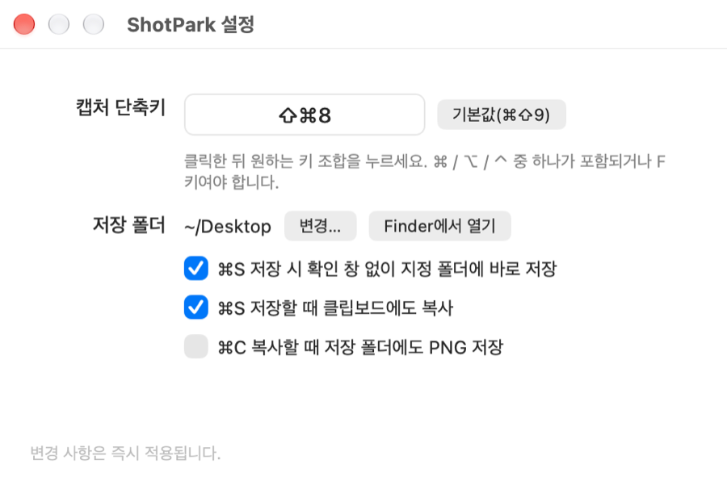
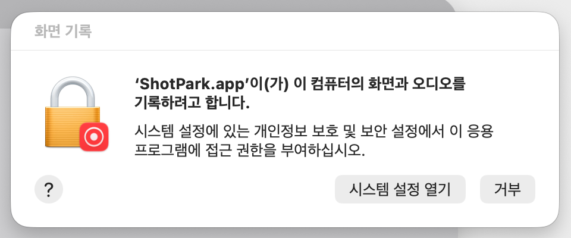
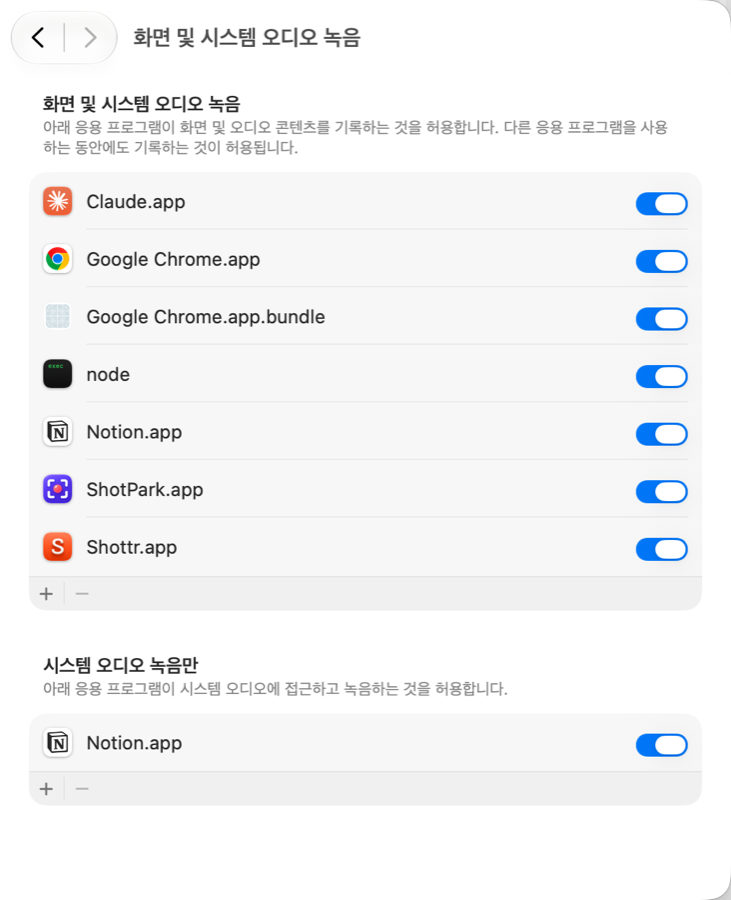

<p align="center">
  
</p>

<h1 align="center">ShotPark</h1>

<p align="center">
  맥에서 화면 한 부분을 잡아 바로 표시하고 보내는 가장 빠른 길<br>
  <b>Apple Silicon 네이티브</b> · 외부 의존성 없음 · 메뉴 막대 상주
</p>

<p align="center">
  <a href="https://github.com/suseokpark/shotpark/releases/latest"></a>
  
  
  <a href="LICENSE"></a>
</p>

<p align="center">
  <a href="https://suseokpark.github.io/shotpark/">홈페이지</a> ·
  <a href="https://github.com/suseokpark/shotpark/releases/latest">다운로드</a> ·
  <a href="#english">English</a>
</p>

<p align="center">
  
</p>

<p align="center"><sub>ShotPark으로 캡처하고 표시한 실제 결과물. <code>⌘⇧9</code> → 지도 위를 드래그 → 원·화살표·텍스트 → <code>⌘C</code>.</sub></p>

---

## 특징

단축키 한 번으로 영역을 선택하여 캡처하고, 바로 표시하여, 공유할 수 있습니다.

## 기능

**캡처**
- 전역 단축키 한 번으로 화면이 어두워지고 드래그로 영역을 선택합니다. 기본 단축키는 `⌘⇧9`, 설정에서 자유롭게 변경.
- 8방향 핸들로 크기 조절, 안쪽을 드래그해 이동, 방향키로 1px(⇧ 10px) 미세 조정, 픽셀 단위 크기 표시, `⌘A` 전체 화면.
- 드래그 대신 **클릭하면 커서 아래 창이 통째로 선택**됩니다(마우스를 올리면 창 테두리가 점선으로 표시됨).
- 다중 모니터 지원. 각 디스플레이의 실제 해상도(Retina)로 캡처합니다.
- ScreenCaptureKit 기반 (macOS 14+), 이전 버전은 자동 폴백.

**주석**
- 펜 · 선 · 화살표 · 사각형 · 타원 · 마커(형광펜) · 텍스트(여러 줄) · 번호 스탬프 · 이모지 도장, 10색 팔레트, 선 굵기 3단계, 실행 취소/다시 실행.
- 넣은 주석은 선택(V) 도구로 드래그해 옮기고, 방향키로 미세 이동, Delete로 지울 수 있습니다. 텍스트는 더블클릭해 다시 편집.
- 텍스트는 크기(16 / 24 / 40 또는 8–200 직접 입력)와 스타일 토글(그림자 · 외곽선 · 배경, 동시 선택 가능)을 옵션 바에서 고르고, 색은 팔레트를 따릅니다. `⌘+` / `⌘-`로 크기 조절.
- 화면에서 보이는 그대로 내보냅니다 (같은 렌더러 사용).

**내보내기**
- `⌘C` 또는 `Enter`로 클립보드에 복사하고 바로 닫힘.
- `⌘S`로 PNG 저장 (`shotpark-20261011-093000.png` 형식) — 설정한 폴더에 확인 창 없이 바로 저장(기본)하거나 저장 창 표시. 저장 후 알림을 클릭하면 Finder에서 파일이 선택됩니다. 저장할 때 클립보드에도 복사(기본 켜짐), 복사할 때 파일로도 저장(옵션)은 설정에서.
- **공유** 버튼(`⌘⇧S`): Claude · Slack · 카카오톡으로 바로 보내기, 또는 macOS 공유 시트(메일 · 메시지 · AirDrop · 메모 등).

**그 외**
- 메뉴 막대에만 상주 (Dock에 안 뜸), 로그인 시 자동 실행 옵션.
- 설정 창: 캡처 단축키, 저장 폴더, 바로 저장 여부.
- 외부 라이브러리 0개. 소스 전체가 Swift 파일 9개.

<p align="center">
  
</p>

## 설치

### 1. 다운로드

[최신 릴리즈](https://github.com/suseokpark/shotpark/releases/latest)에서 `ShotPark-x.y.z.zip`을 받아 압축을 풀고 `ShotPark.app`을 **응용 프로그램** 폴더로 옮깁니다.

### 2. 처음 한 번, Gatekeeper 통과

Apple 개발자 서명이 없는 오픈소스 앱이라 처음 열 때 macOS가 "확인할 수 없는 개발자"라며 막습니다. 둘 중 하나로 한 번만 열어 주면 그 뒤로는 묻지 않습니다.

- **방법 A — 터미널 한 줄** (가장 확실): `xattr -d com.apple.quarantine /Applications/ShotPark.app`
- **방법 B — 설정에서 허용**: 앱을 더블클릭해 경고를 닫은 뒤, 시스템 설정 → 개인정보 보호 및 보안 맨 아래의 **"그래도 열기"**.

### 3. 화면 기록 권한

첫 캡처(`⌘⇧9`) 때 권한 요청 창이 뜹니다. **"시스템 설정 열기"** → 목록에서 **ShotPark**을 켜고, 앱을 한 번 종료했다가(메뉴 막대 아이콘 → ShotPark 종료) 다시 실행하세요.

<p align="center">
  
  &nbsp;
  
</p>

### 소스에서 빌드

Xcode Command Line Tools만 있으면 됩니다 (`xcode-select --install`). 직접 빌드하면 2단계는 필요 없습니다.

```sh
git clone https://github.com/suseokpark/shotpark.git
cd shotpark
./build.sh --install     # 빌드 → 앱 번들 생성 → /Applications 설치 → 실행
```

`./build.sh`만 실행하면 `build/ShotPark.app`만 만들고 설치는 하지 않습니다.

## 사용법

| 동작 | 키 |
|---|---|
| 영역 캡처 시작 | `⌘⇧9` (기본값, 설정에서 변경) · 메뉴 막대 아이콘 → 영역 캡처 |
| 전체 화면 선택 | `⌘A` |
| 펜 / 선 / 화살표 / 사각형 / 타원 / 마커 / 텍스트 / 번호 / 이모지 | `P` / `L` / `A` / `R` / `E` / `M` / `T` / `N` / `S` |
| 선택(이동·크기조절) 모드 | `V` 또는 활성 도구를 다시 클릭 |
| 영역 / 선택한 주석 미세 이동 | 방향키 (`⇧`와 함께 10px) |
| 선택한 주석 삭제 | `Delete` |
| 다시 실행 | `⌘⇧Z` |
| 클립보드로 복사 후 닫기 | `⌘C` 또는 `Enter` |
| PNG 저장 | `⌘S` |
| 공유 메뉴 | `⌘⇧S` |
| 실행 취소 | `⌘Z` |
| 취소 | `Esc` (단계별: 텍스트 입력 → 도구 해제 → 주석 선택 해제 → 영역 해제 → 종료) · 우클릭 |

텍스트 도구(`T`)는 클릭한 자리에 입력 상자가 생기고 `Enter`로 확정, `⇧Enter`로 줄바꿈, `Esc`로 취소합니다. 번호 도구(`N`)는 클릭할 때마다 1, 2, 3… 원형 스탬프를 찍습니다(크기는 텍스트 크기를 따름). 이모지 도장(`S`)은 옵션 바에서 이모지(최근 사용 + 기본 12개, "더보기…"로 시스템 이모지 선택기)와 크기를 고른 뒤 클릭해 찍습니다. 텍스트 도구가 켜져 있으면 툴바 아래에 옵션 바가 나타나 **크기(16 / 24 / 40 프리셋 또는 8–200 직접 입력)** 와 **스타일 토글(그림자 · 외곽선 · 배경 — 여러 개 동시에 켤 수 있음)** 을 바꿀 수 있고, 입력 중에도 바로 반영됩니다. "배경"은 글자 뒤에 상자를 깔아 복잡한 화면 위에서도 또렷하게 보이게 하며, 배경색(흰·검·노랑·연두·하늘·분홍)과 투명도(슬라이더)를 고를 수 있습니다. 글자 색은 팔레트(색상 버튼)로 바꿉니다. 이미 넣은 텍스트는 선택(V)·텍스트(T) 도구에서 드래그해 옮기고, 더블클릭하면 다시 편집할 수 있습니다.

### 설정 (`⌘,` 또는 메뉴 막대 → 설정…)

- **캡처 단축키** — 박스를 클릭하고 원하는 조합을 누르면 즉시 적용. `⌘`/`⌥`/`⌃` 중 하나가 포함되거나 F키여야 합니다.
- **저장 폴더** — 기본은 데스크탑. 아무 폴더나 지정 가능.
- **바로 저장** — 켜두면 `⌘S`가 확인 창 없이 저장. 끄면 저장 창이 뜹니다.
- **저장할 때 클립보드에도 복사** (기본 켜짐) / **복사할 때 저장 폴더에도 PNG 저장** (기본 꺼짐).

## 자주 묻는 질문

**단축키를 눌러도 아무 일도 안 일어나요.**
화면 기록 권한이 아직 없는 경우입니다. 메뉴 막대 아이콘 → "화면 기록 권한 설정…"으로 설정 창을 열어 ShotPark을 켜고, 앱을 종료했다가 다시 실행하세요. 다른 앱이 같은 단축키를 전역으로 잡고 있다면 설정에서 다른 조합으로 바꿔 보세요.

**"손상되었기 때문에 열 수 없습니다"라고 떠요.**
다운로드한 파일에 붙는 격리 속성 때문입니다. 설치 2단계의 `xattr -d com.apple.quarantine /Applications/ShotPark.app`으로 해제하면 됩니다.

**업데이트했더니 화면 기록 권한을 다시 물어봐요.**
정상입니다. 서명이 바뀐 새 빌드는 macOS가 새 앱으로 취급해서 한 번 더 묻습니다. 직접 빌드하는 경우 키체인에 `ShotPark Developer`라는 코드 서명 인증서를 만들어 두면 `build.sh`가 자동으로 그 인증서로 서명해 재빌드 후에도 권한이 유지됩니다.

**"공유 → Slack/카카오톡"은 어떻게 동작하나요?**
이미지를 클립보드에 복사한 뒤 해당 앱에 파일을 넘깁니다. Slack처럼 파일을 받는 앱은 바로 업로드 창이 뜨고, 받지 않는 앱은 앞으로 올라오기만 하므로 `⌘V`로 붙여넣으면 됩니다.

**Intel 맥에서도 되나요?**
빌드 스크립트가 arm64로 고정되어 있습니다. `build.sh`의 `--arch arm64`를 지우고 빌드하면 Intel에서도 돌아갑니다 (테스트는 안 했습니다).

**온라인 업로드/링크 공유는요?**
없습니다. 의도적으로 모든 것이 로컬에서만 처리됩니다.

## 프로젝트 구조

```
Sources/ShotPark/
  main.swift            앱 진입점
  AppDelegate.swift     메뉴 막대 아이템, 메인 메뉴, 전역 단축키 등록, 세션 시작
  HotKey.swift          Carbon RegisterEventHotKey 래퍼 (손쉬운 사용 권한 불필요)
  ScreenCapture.swift   ScreenCaptureKit / CGDisplayCreateImage 폴백
  CaptureSession.swift  모니터별 오버레이 창, 전역 ⌘C/Enter, 클립보드 · 저장 · 공유
  CaptureView.swift     영역 선택, 핸들, 주석 캔버스, 키보드, 결과 렌더링
  Shapes.swift          주석 모델 + 렌더러 (화면/내보내기 동일 코드)
  ToolbarView.swift     플로팅 툴바, 색상 팔레트
  Settings.swift        설정(UserDefaults), 단축키 레코더, 설정 창, 저장 알림
Info.plist              LSUIElement(메뉴 막대 전용), 권한 설명
build.sh                빌드 → .app 번들 → 아이콘 → 서명 → 설치
makeicon.swift          아이콘이 없을 때 쓰는 대체 아이콘 생성 스크립트
docs/                   GitHub Pages 홈페이지 + 스크린샷
```

문서용 스크린샷은 환경 변수로 재현할 수 있습니다: `SHOTPARK_DEMO="x,y,w,h"`(선택 영역, 포인트 단위·좌상단 기준)와 `SHOTPARK_DEMO_SHAPES="ellipse:x1,y1,x2,y2;arrow:…;text:x,y,라벨"`을 주고 실행하면 그 상태로 오버레이가 뜹니다. `SHOTPARK_SETTINGS=1`은 설정 창을 바로 엽니다.

## 기여

이슈와 PR 환영합니다. 큰 변경은 먼저 이슈로 이야기해 주세요. 코드 스타일은 기존 파일을 따르고, 새 기능은 `README`의 기능/단축키 표도 함께 갱신해 주세요.

## 라이선스

MIT © Suseok Park

---

<a id="english"></a>
## English

**ShotPark** is a region screenshot tool for macOS, built natively for Apple Silicon in Swift/AppKit with zero dependencies. Hotkey → drag a region → annotate → copy / save / share.

- Global hotkey (default `⌘⇧9`, configurable), resizable/movable selection, multi-monitor, Retina-resolution capture via ScreenCaptureKit.
- Click a window to select it, or drag a region; resize with handles, nudge with arrow keys.
- Annotations: pen, line, arrow, rectangle, ellipse, marker, multi-line text (shadow / outline / background box), numbered stamps, emoji stamps; 10-color palette, 3 stroke widths, undo/redo; move or delete any annotation afterwards.
- `⌘C`/`Enter` copies to clipboard, `⌘S` saves `shotpark-yyyyMMdd-HHmmss.png` directly to a folder of your choice, `⌘⇧S` shares to Claude / Slack / KakaoTalk or the macOS share sheet.
- Menu-bar only, launch-at-login option, settings window.

**Install:** grab `ShotPark-x.y.z.zip` from the [latest release](https://github.com/suseokpark/shotpark/releases/latest), move `ShotPark.app` to Applications, clear the quarantine flag once (`xattr -d com.apple.quarantine /Applications/ShotPark.app`, or allow it under System Settings → Privacy & Security → "Open Anyway"), then grant **Screen Recording** permission on first capture and relaunch.

**Build from source:** `git clone https://github.com/suseokpark/shotpark.git && cd shotpark && ./build.sh --install` (needs Xcode Command Line Tools). Requires macOS 13+.

The UI is currently Korean; the shortcut table above applies as-is. MIT licensed.
